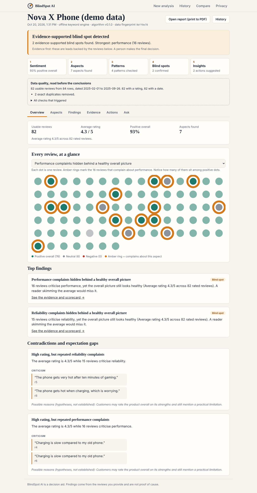
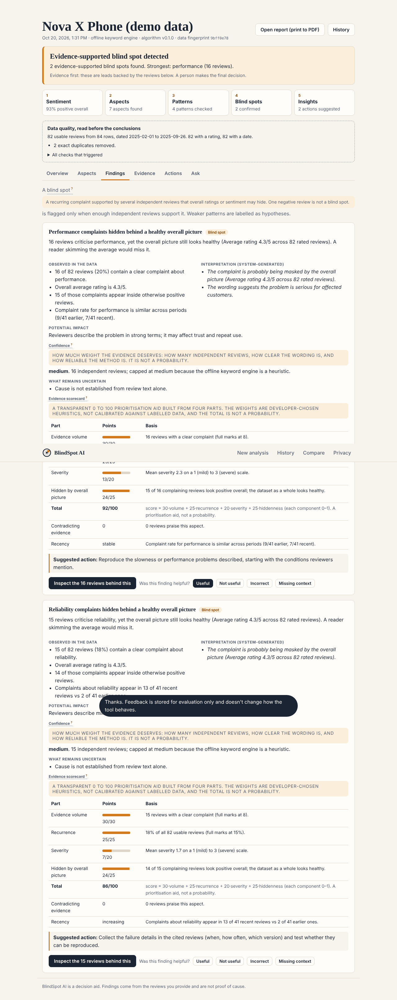
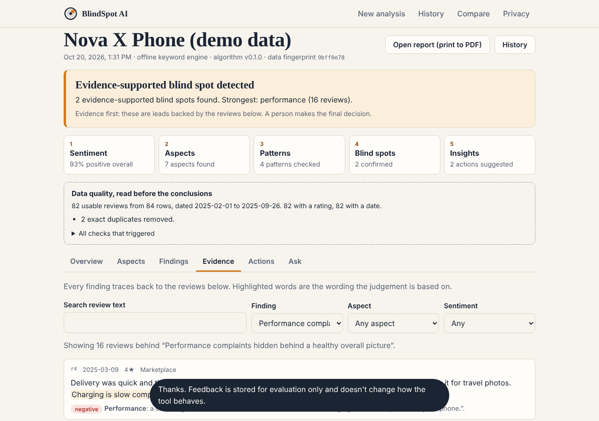
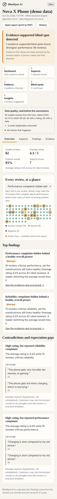

# BlindSpot AI

Review intelligence that finds the patterns your star rating hides.

BlindSpot AI reads a batch of customer reviews, works out what people say about each **aspect** (quality, price, delivery, service, reliability, usability, cleanliness, packaging, performance), and flags **blind spots**: recurring complaints, supported by several independent reviews, that a healthy average rating would hide. Every finding links to the exact reviews behind it, states its confidence and uncertainty, and ends with a practical next step.

> A negative review is not automatically a blind spot. When the evidence is thin, BlindSpot AI says so instead of inventing a finding.

**Project:** Full Stack Development with AI · III Year – A2 · Guide: Dr. V. Saranya

|  |  |
| --- | --- |
| Overview: every review as a dot, with complaint reviews ringed in amber | Finding with observed vs interpreted statements and a transparent scorecard |
|  |  |
| Evidence Explorer with highlighted wording | Responsive mobile layout |

## How it works: five steps, nine modules
**Sentiment → Aspects → Patterns → Blind spots → Insights.** The rule throughout is **evidence first**: nothing is reported without the reviews behind it, and a person makes the final decision.

| # | Module | Code |
| - | --- | --- |
| 1 | Review input (CSV, pasted text, demo data) | `src/client/app.ts`, `src/engine/csv.ts` |
| 2 | Cleaning and validation | `src/engine/ingest.ts` |
| 3 | Sentiment analysis | `src/engine/lexicon.ts` (offline) or `llm.ts` (optional AI) |
| 4 | Aspect extraction (camera, battery, service…) | `src/engine/taxonomy.ts`, `lexicon.ts` / `llm.ts` |
| 5 | Pattern detection (recurrence, contradictions, trends) | `src/engine/detect.ts` |
| 6 | Evidence checker (scorecard, supporting reviews) | `src/engine/detect.ts`, `analyze.ts` |
| 7 | Blind-spot detector (four possible outcomes) | `src/engine/detect.ts` |
| 8 | Insights and recommendations (plus Ask and Compare) | `src/engine/recommend.ts`, `ask.ts`, `compare.ts` |
| 9 | Results interface and report | `src/client/results.ts`, `src/engine/report.ts` |

## Problem statement
Average ratings and plain positive/negative sentiment blur everything together. A product rated 4.5 can still have a battery problem that a fifth of reviewers mention, which is easy to miss when skimming. Teams need to know *what* is recurring, *how many* independent reviews say it, *whether the overall picture hides it*, and *how sure* the tool is.

## Features
Working end to end (tested, see below):
- **Input:** CSV upload (header row; `review`/`text`/`comment` column, optional `rating`, `date`, `source`, `url`), pasted reviews, or built-in demo datasets.
- **Data quality first:** empty rows, exact duplicates (removed), near-duplicates (flagged, not accused), very short reviews, missing/invalid ratings and dates. Limitations are shown before conclusions.
- **Aspect-level sentiment:** counts and shares per aspect, representative evidence, per-aspect confidence. An aspect is only negative where reviewers express negative sentiment about it.
- **Blind-spot engine with an evidence scorecard:** 0–100 prioritisation score from evidence volume, recurrence, severity and how much the overall picture hides it. Formula and weights are shown in the UI. It is **not** a probability.
- **Four possible outcomes:** blind spot detected · potential pattern · no blind spot established · insufficient data.
- **Contradictions & expectation gaps:** mixed opinions, "high rating but repeated complaints", "not as advertised".
- **Time trends:** earlier vs later complaint rates, only with enough dated reviews, with period sizes shown.
- **Evidence Explorer:** original text, date, rating, source, link (http/https only), detected sentiment, why it supports the finding, observed vs inferred labelled.
- **Recommendations:** action, reasoning, cautious expected benefit, priority, what to measure. Hypotheses are marked "confirm first".
- **Ask BlindSpot AI:** answers assembled only from the stored analysis; it declines what the data can't support.
- **Compare two datasets** with warnings for size or period mismatch.
- **Printable report** (open it and use *Print → Save as PDF*).
- **History, feedback and privacy:** analyses are private to your browser, only cited evidence text is stored, one-click delete of everything, feedback buttons (stored for evaluation only; they never change behaviour).

## Which parts use AI?
| Step | Method |
| --- | --- |
| Aspect extraction and sentiment | **Offline keyword/lexicon engine** (deterministic heuristic, default). Optionally **LLM-assisted** if `ANTHROPIC_API_KEY` is set. |
| Duplicate detection, trends, scoring, blind-spot classification, recommendations, Ask, Compare, report | **Deterministic rules** (no LLM) so results are reproducible and explainable |

With an API key, review text is sent to the AI provider for extraction only. It is sent as quoted data with instructions to ignore any commands inside it, output is validated, quotes that aren't verbatim in the review are discarded, and any failing batch falls back to the offline engine. Without a key, nothing leaves the server.

## Architecture
```
Browser (TypeScript, no framework) ── JSON ──> node:http API ──> SQLite (node:sqlite)
                                                  │
                                   src/engine  (pure TypeScript, no web imports)
   ingest.ts → lexicon.ts | llm.ts → detect.ts → recommend.ts → analyze.ts
                         ask.ts · compare.ts · report.ts
```
- `src/engine`: parsing, validation, extraction, detection. Independent of the web layer, so it can be tested alone.
- `src/server`: HTTP API, per-browser ownership, rate limiting, size limits, security headers, SQLite storage, demo data.
- `src/client`: the interface. Review text is only ever set as text, never HTML.
- Stack choice: zero runtime dependencies (Node 22 built-ins only: `node:http`, `node:sqlite`, `node:test`, native TypeScript type stripping). That keeps setup to two commands.

## Requirements
Node.js **22.18 or newer**. (`npm install` only adds dev tools: TypeScript and Node types for type-checking.)

## Setup and run
```bash
git clone https://github.com/aristatil-gif/BlindSpot-AI.git
cd BlindSpot-AI
npm install        # optional: only needed for `npm run typecheck`
cp .env.example .env   # optional
npm start          # builds the client and starts http://localhost:3000
```
Environment variables (all optional) are in `.env.example`. To use AI-assisted extraction, export `ANTHROPIC_API_KEY` before `npm start` (the app reads the process environment; it does not load `.env` by itself, e.g. `export $(grep -v '^#' .env | xargs)` first).

## Sample usage
1. Open http://localhost:3000, choose **Try a sample → Nova X Phone (demo data)** (first option) and press **Analyse reviews**.
2. Expect: the camera is praised, while **heating** (Reliability) and **slow charging** (Performance) are flagged as blind spots hidden behind a ~4.3★ average, with evidence for each. (*Brightline Earbuds* shows a battery blind spot with a rising trend.)
3. Open **Findings → Inspect the reviews** to see the evidence; try **Ask**; open **Compare** after also running *Earbuds Pro*.
4. Try *Corner Table Café* (expect: **no blind spot**) and *Three reviews* (expect: **insufficient data**).

The demo datasets are synthetic and labelled as demo data. They are not real customer reviews.

## Testing
```bash
npm test            # 27 tests: engine + HTTP API
npm run typecheck   # needs `npm install`
```
| # | Scenario | Result |
| - | --- | --- |
| 1 | Mostly positive reviews with a recurring complaint → blind spot with evidence | Pass |
| 2, 12 | Mostly negative, no recurring issue → no blind spot | Pass |
| 3 | Mixed opinions → contradiction with both sides | Pass |
| 4 | Duplicates removed; near-duplicates flagged | Pass |
| 5 | Empty / malformed CSV, no review column, unterminated quote | Pass |
| 6 | Missing ratings/dates reported as limitations | Pass |
| 7 | Very small dataset → insufficient data | Pass |
| – | Phone demo: camera praised, heating and slow charging flagged with evidence | Pass |
| 8 | Sarcasm → ambiguous, not counted as a complaint | Pass |
| 9 | Irrelevant reviews → no aspects, no findings | Pass |
| 10 | AI failure, timeout, malformed output, transient 5xx retry → offline fallback | Pass (mocked AI client) |
| 11 | Prompt injection in a review; fabricated AI quotes discarded | Pass |
| 13 | Two datasets of different sizes → comparison warnings | Pass |
| 14 | Mobile and desktop layouts | Checked in a real browser (Chromium, 1280px and 390px): full workflow, no horizontal overflow, no console errors |
| 15 | Another user cannot read, report on, ask about, delete or compare someone else's analysis | Pass |
| – | Upload limits, binary file, invalid JSON, rate limiting (429), path traversal | Pass |

## Known limitations
- The offline engine is a keyword/lexicon heuristic. It misses nuance, irony and domain slang, and its confidence is capped at **medium**. It has **not** been evaluated on a labelled dataset, so no accuracy figure is claimed.
- Scorecard weights and thresholds are developer-chosen heuristics, not calibrated.
- AI-assisted mode is covered by tests with a mocked client. It has not been exercised against the live API in this repository's test run.
- English reviews only. Dates must be unambiguous (`2025-03-14`); ambiguous ones (`03/04/2025`) are ignored rather than guessed.
- No user accounts: privacy is per browser (cookie). Clearing cookies orphans previously saved analyses.
- Up to 500 reviews and about 1 MB per analysis. The built-in rate limiter is in-memory and per process.
- Review text alone cannot establish *why* a problem happens; "possible reasons" are labelled as hypotheses.

## Project structure
```
src/engine/   analysis pipeline (pure TypeScript)
src/server/   HTTP API, SQLite, demo data
src/client/   interface sources (built to public/ by scripts/build-client.mjs)
tests/        node:test suites
docs/         screenshots
```
